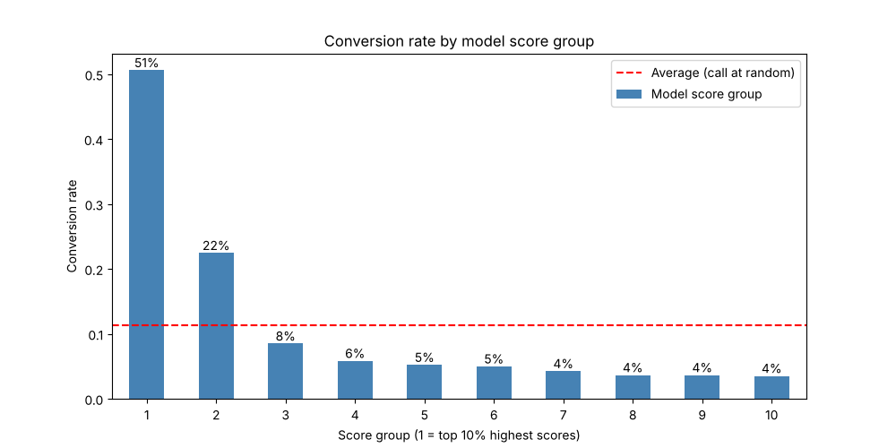
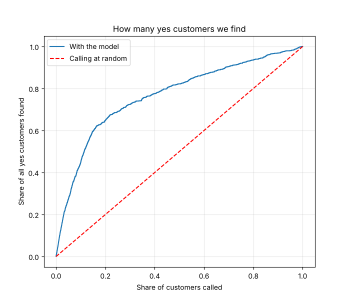

# Who Should We Call? Predicting Term-Deposit Sign-ups

Calling the model's top 30% of customers reaches **72% of all buyers with 70% fewer calls**.

This project is Stage 1 (regression) of my machine learning practice: an exploration of a bank's phone-marketing campaign, followed by a logistic regression model that scores every customer by their chance of saying yes.

## Contents

| File | What it is |
| --- | --- |
| `01_regression.ipynb` | The notebook: exploration (Part 1) and the scoring model (Part 2) |
| `data/bank_marketing.csv` | The dataset (semicolon-separated) |
| `DATA_DICTIONARY.md` | Meaning, type and value range of all 21 columns |
| `images/` | Charts used in this README |
| `requirements.txt` | Python packages needed |

## 1. The problem and the data

A Portuguese bank phoned its customers to sell a term deposit. Only 11.3% said yes, so roughly 9 calls in 10 were wasted. The question: **who should we call?**

| Item | Value |
| --- | --- |
| Source | [UCI Machine Learning Repository, Bank Marketing](https://archive.ics.uci.edu/dataset/222/bank+marketing) (Moro, Cortez & Rita, 2014), CC BY 4.0 |
| Customers (rows) | 41,188 |
| Columns | 21 (20 features + target `y`) |
| Said yes | 4,640 (11.3%) |
| Said no | 36,548 (88.7%) |
| Removed before modelling | `duration` (call length, only known after the call: data leakage) |

Data traps found: `unknown` is a text value, not a missing value; `pdays = 999` means "never contacted before" (96% of rows).

## 2. Part 1: Exploring who converts

Past buyers, older retired customers and young students convert far above the 11.3% average; loans and education barely matter. Each rate below is the share of **that group** who said yes (`groupby` + `mean`), not the group's share of all customers.

| Feature | Best group (customers, rate) | Worst large group (customers, rate) | Verdict |
| --- | --- | --- | --- |
| Previous campaign (`poutcome`) | said yes before: 1,373, **65.1%** | never contacted: 35,563, 8.8% | Strongest signal |
| Age group | 65+: 663, **47.2%** | 35-44: 13,500, 8.7% | Strong |
| Job | student: 875, **31.4%** | blue-collar: 9,254, 6.9% | Strong, overlaps with age |
| Education | university degree: 12,168, 13.7% | basic.9y: 6,045, 7.8% | Weak |
| Personal loan | no loan: 33,950, 11.3% | loan: 6,248, 10.9% | No effect |

Three things to remember from Part 1:

- **Rate vs. volume.** Students convert best (275 yes), but admin brings 1,352 yes at only 13.0%, because the group is 12 times larger.
- **Small groups mislead.** `illiterate` shows 22.2%, but that is 4 people out of 18. Distrust groups under about 100.
- **Features overlap.** Most 65+ customers are retired (560 of 663) and most under-25s are students (378 of 1,068), so age and job tell the same story twice. A past "no" (14.2%) still beats never contacted (8.8%): a warm audience beats a cold one.

Best segments found by combining age and job (groups of 100+ only):

| Segment | Customers | Said yes | Rate |
| --- | --- | --- | --- |
| Retired, 65+ | 560 | 264 | 47.1% |
| Students, under 25 | 378 | 143 | 37.8% |
| Students, 25-34 | 433 | 121 | 27.9% |

## 3. Part 2: The scoring model

A logistic regression gives every customer a probability of saying yes; ranking by that score finds buyers 4.5 times faster than calling at random.

1. **Prepare:** `y` = said yes (1/0); `X` = the other 19 columns, without `y` and `duration`.
2. **Split:** 32,950 customers to train, 8,238 to test (928 yes in the test set), with `stratify=y, random_state=42`.
3. **Translate:** `OneHotEncoder` for text columns, `StandardScaler` for numbers: 19 columns become 62.
4. **Train:** a `Pipeline` of the translation plus `LogisticRegression(max_iter=1000)`, then `model.fit(X_train, y_train)`.
5. **Score:** `model.predict_proba(X_test)[:, 1]` gives each test customer a 0 to 1 score; sort highest first.
6. **Check:** how many yes's the top of the list really holds.

Only the top two groups beat the average; from group 3 down, every group converts below random calling.

| Strategy | Customers called | Conversion rate | Yes found (of 928) | Share of all buyers |
| --- | --- | --- | --- | --- |
| Call 10% at random | 823 | 11.3% | about 93 | 10% |
| Model top 10% | 823 | 50.4% | 415 | 44.7% |
| Model top 30% | 2,471 | 27.2% | 672 | 72.4% |

The top 30% is not mostly retired people and students (15%): 74% were never contacted before, and admin (29%), blue-collar and technician lead. The model finds good customers a simple rule would miss.

Accuracy is a trap here: the model scores 90.1%, but predicting "no" for everyone already scores 88.7%. Judge it by the call list instead.

## 4. Conclusion: the recommendation

Call only the top 30% of the model's list, starting with previous buyers.

> Instead of calling every customer, we'll call only the top 30% of the model's list. This group converts at 27%, compared with 11% when calling at random, and it reaches 72% of all customers who would say yes. We start with previous buyers, who convert at 65%. This cuts the number of calls by 70% while keeping almost three-quarters of the sales, saving call-center time and budget.

The trade-off: about 28% of buyers sit outside the top 30% and would not be called. Previous buyers convert well because they likely already trust the bank (correlation, not cause), so avoid calling them too often.

## 5. Lessons and bugs fixed

Most mistakes came from small code details, and each one left a clear clue in the numbers.

| Symptom | Cause | Fix |
| --- | --- | --- |
| Whole table in one column | File read without the separator | `pd.read_csv(path, sep=';')` |
| Age groups showed 619 and 1,666 people instead of 663 and 1,068 | Bins included the upper edge, so a 25-year-old landed in "<25" | `pd.cut(..., right=False)` |
| `'AxesSubplot' object has no attribute 'bar_label'` and `module 'numpy' has no attribute 'float'` | Notebook ran an old Python environment | Select the `.venv` kernel, or `%pip install --upgrade` |
| Top 10% converted at 11.4%, same as random | `sort_values` result not saved | `results.sort_values('score', ascending=False).head(...)` in one line |
| 935 yes in the test set instead of 928 | `stratify=y` missing in the split | `train_test_split(..., stratify=y, random_state=42)` |

Habits to keep:

- Read `count` next to `mean`, and ask which group a number describes before presenting it.
- Remove anything only known after the outcome (`duration`): that is data leakage.
- A result no better than random is a red flag: check the code before blaming the model.

**Next steps:** look inside the model at its coefficients (does education get a small weight?), then Stage 2, clustering.
